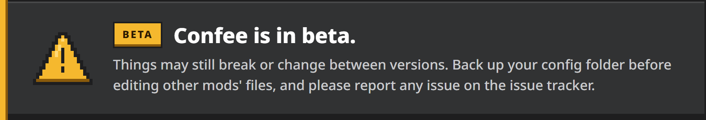

Config library for Minecraft mods. Declare your options in one class: Confee writes the file, loads it, validates it,
and gives your mod a Bedrock-style config screen in Mod Menu and in the Forge/NeoForge mod list. You write no screen
or integration code.

Minecraft 1.20.2 · Fabric, Quilt, NeoForge, Forge · Java 17 · LGPL-3.0

> **Playing, not coding?** Confee also adds a **Config** button to mods that have none. See [For players](docs/players.md).

## Getting started

### 1. Add the dependency

Confee is published on the Modrinth Maven:

```groovy
repositories {
    maven {
        url = 'https://api.modrinth.com/maven'
        content { includeGroup 'maven.modrinth' }
    }
}

dependencies {
    // Fabric, Quilt (Loom)
    modImplementation 'maven.modrinth:confee:<version>+1.20.2-fabric'

    // NeoForge (NeoGradle)
    implementation 'maven.modrinth:confee:<version>+1.20.2-neoforge'

    // Forge (ForgeGradle)
    implementation fg.deobf('maven.modrinth:confee:<version>+1.20.2-forge')
}
```

Players need the Confee jar next to your mod, so declare it as a required dependency:

```json
// fabric.mod.json (Fabric, Quilt)
"depends": { "confee": "*" }
```

```toml
# mods.toml (Forge, NeoForge)
[[dependencies.examplemod]]
modId = "confee"
mandatory = true
versionRange = "*"
ordering = "NONE"
side = "BOTH"
```

Embedding Confee in your jar (jar-in-jar) is not supported.

### 2. Declare the config

```java
@Config(modId = "examplemod")
public class ExampleConfig {
    @Comment("Show the HUD")
    public boolean showHud = true;

    @Category("dash") @Range(min = 1, max = 10) @Slider(step = 0.5)
    public double dashDistance = 4.0;
}
```

The public fields are the options, and their initial values are the defaults.

### 3. Register it and read it

```java
// in your mod initializer (Fabric, Quilt, Forge and NeoForge alike)
public static final ConfeeConfig<ExampleConfig> CONFIG = Confee.register(ExampleConfig.class);

// anywhere
if (CONFIG.get().showHud) { ... }
```

That's it. Confee creates `config/examplemod.toml`, with comments and range hints:

```toml
#: Show the HUD
showHud = true

[dash]
#: Range: 1.0 ~ 10.0
dashDistance = 4.0
```

and your mod's **Config** button opens the generated screen.

### 4. Check what Confee understood

In a development environment, Confee logs a report for each config: the file, each option with the widget it gets
and its constraints, and the translation keys still missing (ready to copy into your language file):

```text
[Confee] Dev report for examplemod (shown in development only)
  file: config/examplemod.toml (TOML, scope COMMON)
  2 option(s), 1 section(s)
  - showHud            toggle
  - dash.dashDistance  slider  [range 1.0 ~ 10.0, step 0.5]
  names: 2 option(s) without translation nor @Name in assets/examplemod/lang/en_us.json (the field name is shown instead):
      "config.examplemod.showHud": "...",
      "config.examplemod.dash.dashDistance": "...",
```

A mistake in the declaration (for example `@Slider` without `@Range`) stops the game in development, with every
mistake of the class listed and how to fix each one. Players never see these errors: in production the field is
skipped with a warning.

## Annotations or builder?

Both give the same file and the same screen. Pick one per config.

| | Annotations | Builder |
| --- | --- | --- |
| You write | one class with public fields | calls in your initializer |
| You read a value with | `CONFIG.get().showHud` | `SHOW_HUD.get()` (a `ConfigValue<T>` per option) |
| Best when | the options are known in advance | options are built from code, or you want a handle per value |

```java
// the same option, both ways
@Range(min = 0, max = 100) @Slider(step = 5) @Unit("%")
public int volume = 70;

VOLUME = b.intRange("volume", 70, 0, 100).slider(5).unit("%").build();
```

The [builder guide](docs/builder.md) shows the full setup.

## Recipes

Each recipe shows the annotation, then the builder equivalent.

**A list of items (icons, suggestions, item picker, no duplicates)**

```java
@Item(tags = true) @Size(max = 9)
public List<String> loot = new ArrayList<>(List.of("minecraft:diamond", "#minecraft:logs"));

b.itemList("loot", "minecraft:diamond", "#minecraft:logs").tags().maxSize(9).build();
```

**An option that only makes sense when another is on**

```java
public boolean showHud = true;

@EnabledIf("showHud")             // greyed out; @VisibleIf hides it instead
public int hudOpacity = 80;

b.intValue("hudOpacity", 80).enabledIf("showHud").build();
```

**A choice between a few values**

```java
public Difficulty difficulty = Difficulty.NORMAL;   // 2 to 4 values: segmented buttons, more: a dropdown

b.enumValue("difficulty", Difficulty.NORMAL).build();
```

**React when the player saves**

```java
CONFIG.onChange(() -> Hud.refresh());                                   // after a save from the screen
SHOW_HUD.addListener((oldValue, newValue) -> Hud.setVisible(newValue));  // each time this value changes
```

**Open the screen from your own button (client only)**

```java
minecraft.setScreen(CONFIG.createScreen(currentScreen));
```

**Names and tooltips in several languages**

```json
"config.examplemod.dash.dashDistance": "Dash distance",
"config.examplemod.dash.dashDistance.tooltip": "How far the dash goes, in blocks"
```

## Documentation

| Page | What's in it |
| --- | --- |
| [Annotations](docs/annotations.md) | Every annotation, grouped by use, and the supported field types. |
| [Builder](docs/builder.md) | Declaring a config from code: option methods and modifiers. |
| [Lists](docs/lists.md) | Duplicates, size, sorting, order, bounds of each value. |
| [IDs and registries](docs/registries.md) | Item, block, mob, biome... fields, tags, filters, mod IDs and pickers. |
| [Screen](docs/screen.md) | Previews, layout, decorations, theme colors, your own widgets. |
| [Using a config](docs/using-a-config.md) | Reading, saving, reloading, listeners, scopes, file formats, robustness. |
| [Translations](docs/translations.md) | Language keys for names, tooltips and descriptions. |
| [For players](docs/players.md) | Installing Confee and the editor for mods that do not use it. |

## API stability

Only the `fr.heetstudio.confee.api` package (and its sub-packages) is public API. Everything else is internal and can
change in any version.

## Building from source

Each Minecraft version has its own branch (`1.20.1`, …). On Windows, `scripts\confee.ps1` picks a suitable JDK and runs
the usual tasks:

```powershell
.\scripts\confee.ps1 fabric        # game client, Fabric + Mod Menu + test mods
.\scripts\confee.ps1 forge         # game client, Forge + test mods
.\scripts\confee.ps1 test          # unit tests
.\scripts\confee.ps1 jars          # build the jars
.\scripts\confee.ps1 publish-dry   # what would be published to Modrinth / CurseForge, without publishing
```

To contribute, see [CONTRIBUTING.md](CONTRIBUTING.md).

## License

[LGPL-3.0](LICENSE). Author: Heet.
